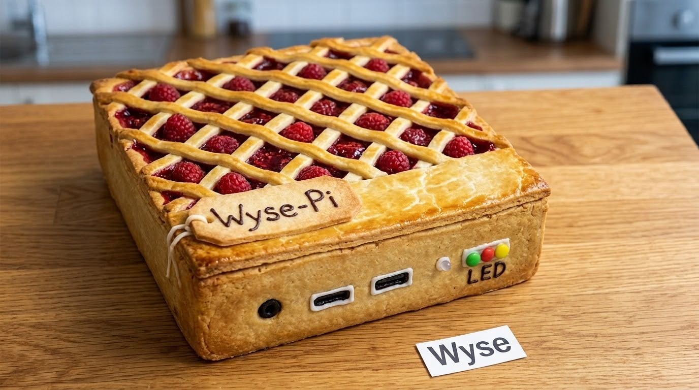
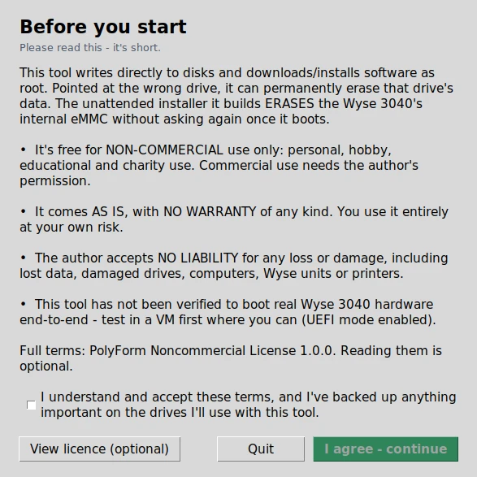
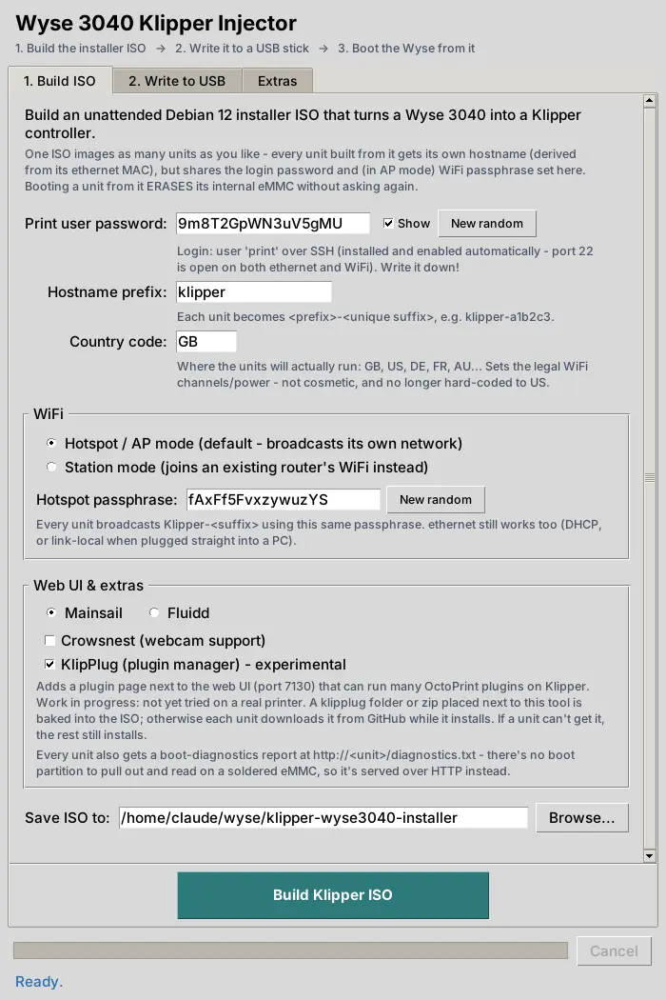
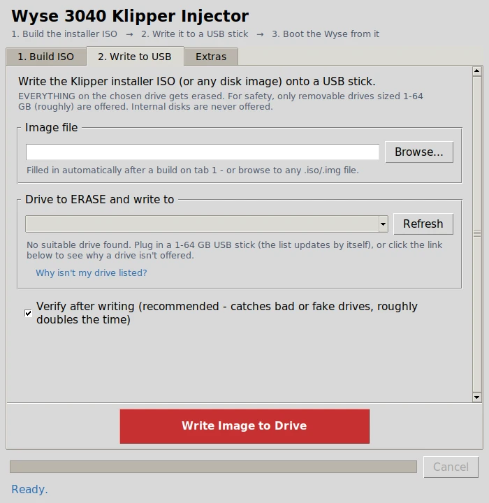
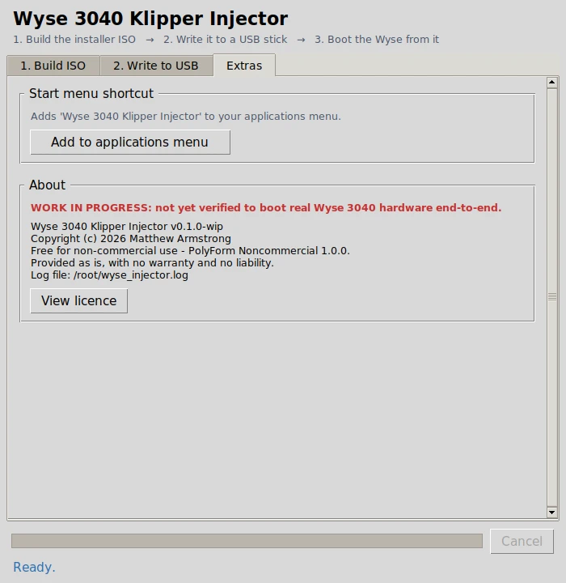

# Klipper unattended installer for Dell Wyse 3040

> **WORK IN PROGRESS: MANY FEATURES MAY BE BROKEN.** This has not been
> verified to boot real Wyse 3040 hardware end-to-end yet (see
> [Known limitations](#known-limitations)). Test it in a VM before you
> image real units, and expect to fix things.

Source-available · Non-commercial — see [Licence](#licence) below.



Builds a bootable USB installer that wipes a Wyse 3040's internal eMMC and
leaves it running a headless Debian 12 appliance with Klipper + Moonraker +
a web UI (Mainsail or Fluidd), WiFi (hotspot or station mode), and a working
ethernet port. Designed for imaging a batch of units one at a time from the
same USB stick .

## Screenshots

The GUI (`wyse_injector.py` — see below):

| | |
|---|---|
|  |  |
| First launch — read this before agreeing | Tab 1: set everything about the build |
|  |  |
| Tab 2: flash the built ISO onto a USB stick | Tab 3: desktop shortcut, licence, about |

<!-- Real hardware photos: once these exist, uncomment. See PUBLISHING.md
for how to add them (resize to ~1600px wide, strip EXIF/GPS first).
|  |  |
|---|---|
|  | |
-->

## Licence

Copyright (c) 2026 Matthew Armstrong. Licensed under the
[PolyForm Noncommercial License 1.0.0](LICENSE.md) — **source-available, not
open source** (it's not OSI-approved). In short: free to use, modify and
share for personal, hobby, educational or charity use; commercial use needs
the author's permission; provided AS IS with **no warranty and no
liability**. Not legal advice — read [LICENSE.md](LICENSE.md) for the actual
terms. Third-party components (Debian, Klipper, Moonraker, Mainsail, Fluidd,
Crowsnest, KlipPlug) keep their own licences — see [THIRD_PARTY.md](THIRD_PARTY.md).

This tool writes directly to disks as root. Pointed at the wrong drive, it
can permanently erase that drive's data, and the installer it builds erases
a Wyse 3040's internal eMMC without asking again once it boots. You use it
entirely at your own risk.

## Building the ISO — GUI (recommended)

**Linux:** double-click `WyseInjector-Linux.sh` (or run it from a
terminal). It finds Python 3 + Tkinter itself and tells you exactly what to
install if either is missing.

**Windows / macOS:** this tool needs real Linux disk/build tooling
(`apt-get`, `lsblk`, `xorriso`, `rsync`) and writes directly to Linux block
devices — there's no safe way to run it natively on either. Double-clicking
`WyseInjector-Windows.bat` walks you into WSL2 Ubuntu (installing WSL2 first
if needed); `WyseInjector-Mac.command` explains the same thing and points
you at a Linux VM or a real Linux PC. Once you're in a Linux environment
(including WSL2), it's the same `python3 wyse_injector.py` as above.

Prefer the command line directly?

```bash
python3 wyse_injector.py
```

A point-and-click tool, built on the same tested foundation as the sibling
[Pi Hotspot Injector](https://github.com/The-Dorkknight/pi-hotspot-injector)
project (same disk-safety checks, resumable/checksum-verified downloads, and
two-step "type the drive name" confirmation before anything destructive
happens). It has three tabs:

1. **Build ISO** — set the print-user password, hostname prefix, WiFi
   country code, WiFi mode (hotspot/AP or join-an-existing-router/station),
   web UI (Mainsail or Fluidd), optional Crowsnest webcam support and the
   optional, experimental KlipPlug plugin manager (see below), then
   builds `klipper-wyse3040-installer.iso`. On success it shows the SSH
   login (`print@<hostname>.local`, port 22, open on both ethernet and
   WiFi) and password up front — also saved to `credentials.txt` next to
   the ISO.
2. **Write to USB** — flash the built ISO onto a USB stick. Only
   removable, correctly-sized drives are offered; internal disks are never
   listed.
3. **Extras** — add a proper applications-menu shortcut (so you don't need
   a terminal next time), and an About box with the licence.

It needs the same build dependencies as `setup.sh` below (`xorriso`,
`p7zip-full`, `wget`, `rsync`, isolinux) — it installs any that are missing
via `apt` the first time you build, same as `setup.sh` does. It also needs
Tkinter for the GUI itself, which isn't always preinstalled:

```bash
# Debian / Ubuntu / Mint
sudo apt install python3-tk
# Fedora
sudo dnf install python3-tkinter
# Arch
sudo pacman -S tk
```

Run it with `python3 wyse_injector.py` — it asks for your password itself
(via `pkexec`) the moment it needs root, rather than requiring `sudo` up
front.

One thing it does **not** do yet: a fast local pre-build cache (build
Klipper/Moonraker's venvs once, reuse across units, instead of every single
unit re-cloning and re-`pip install`-ing from scratch during provisioning).
Right now every unit still does that work itself during the unattended
install, same as `setup.sh`'s output always has. Worth a follow-up if
you're imaging a lot of units and the 10–20 minutes/unit adds up.

## Hardware reality check (Wyse 3040 / N10D)

- **CPU**: Atom x5-Z8350, 64-bit, 4 core — plenty for klippy + Moonraker.
- **RAM**: 2GB, soldered, not upgradable on *any* 3040. This shapes several
  choices below (no desktop environment, zram instead of a swap partition,
  a fairly minimal package set).
- **Storage**: 8GB (or 16GB on some units) eMMC, soldered, seen as
  `/dev/mmcblk0` normally. A minimal Debian + Klipper stack lands around
  1.5–2GB installed, so 8GB is comfortable, not tight.
- **Boot quirk**: the 3040's UEFI firmware does not reliably persist normal
  boot-entry (NVRAM) registrations — this is a documented issue in the
  Wyse-3040 hobbyist community, not something specific to this installer.
  If GRUB is installed the normal way, the unit can come up with no boot
  device found. The fix, baked into `preseed.cfg`, is to force GRUB onto
  the EFI *removable media* fallback path
  (`grub-installer/force-efi-extra-removable`), which is exactly the
  documented Debian workaround for "broken UEFI firmware."
- **WiFi**: the factory-fit module (when present — many surplus/refurbished
  units ship *without* it, since it's a socket option) is a Marvell 8897 on
  an M.2 SDIO card. Its Linux AP-mode driver support (`mwifiex_sdio`) has a
  real history of BSS-start timeouts and TX hangs in AP mode. Given "AP mode
  by default" is a hard requirement here, **the recommended path is a cheap
  USB WiFi dongle** with a chipset known to be solid in `hostapd` AP mode
  (e.g. Realtek RTL8188EUS-based dongles are common and well supported).
  The config here doesn't care which one you use — anything that shows up
  as `wlan0` works, and interface naming is pinned to that (see below). The
  internal SDIO card will also work as a best-effort fallback if that's all
  you have, just don't be surprised if it occasionally needs a `systemctl
  restart hostapd`.
- **Ethernet**: Realtek RTL8111/8168 Gigabit — supported by the mainline
  `r8169` driver, no firmware blob needed, just works.

## What the installed system looks like

- Debian 12 (bookworm), headless, no desktop.
- `eth0`: DHCP client with automatic link-local (169.254.x.x) fallback, so
  it works both plugged into a router/switch **and** plugged directly into
  a PC with no DHCP server. Advertises itself over mDNS (avahi) as
  `<hostname>.local`.
- `wlan0`, one of two mutually-exclusive modes, chosen at build time
  (`WIFI_MODE` in `overlay/options.env`, set by the GUI or `setup.sh`):
  - **AP/hotspot mode (default)**: always up as a hotspot (`hostapd` +
    `dnsmasq`), static `192.168.7.1`, SSID `Klipper-<unique suffix>` — the
    suffix is derived from that unit's real ethernet MAC address during
    install, so a batch of units don't all broadcast an identical
    SSID/hostname.
  - **Station/client mode**: joins an existing router's WiFi instead, via
    `wpa_supplicant`, as a normal DHCP client (ethernet is still preferred
    when both links are up — station WiFi has a higher route metric).
- SSH (`openssh-server`) is installed and enabled automatically by Debian's
  own base install (`pkgsel/include` in `preseed.cfg`) — it's not a
  separate step in `late-command.sh`. Login is `print@<hostname>.local` (or
  the unit's IP), port 22, open on ethernet and WiFi alike.
- Klipper (`klippy`) + Moonraker, each in their own venv, running as the
  `print` user, as systemd services.
- Mainsail or Fluidd (your choice at build time) served by `nginx` on port
  80, proxying Moonraker's API/websocket. Optional Crowsnest webcam
  streaming, also a build-time choice.
- Optionally, the experimental **KlipPlug** plugin manager as its own
  service on port 7130 (see [The KlipPlug option](#the-klipplug-option-experimental)).
- A one-shot boot-diagnostics report at `http://<unit>/diagnostics.txt`
  (OS/network/WiFi/Klipper/Moonraker/disk/memory status, collected ~100s
  after boot) — since the eMMC is soldered in, there's no boot partition to
  pull the unit apart and read the way you can with an SD card, so it's
  served over HTTP instead.
- `net.ifnames=0` on the kernel command line, so interfaces are always
  `eth0`/`wlan0` regardless of which specific NIC/wifi hardware is fitted.
- zram-backed swap (RAM-only, no eMMC wear) instead of a swap partition.
- Fresh, per-unit SSH host keys (a normal side effect of each unit running
  its own full install — nothing special needed there).

## Building the ISO — GitHub Actions (recommended, no local install)

No WSL, no Docker, nothing installed on your PC — the build runs on
GitHub's own Linux runners.

1. **Push this project to a GitHub repo, and make it private.** This
   matters: the finished ISO and `credentials.txt` both contain the login
   password and WiFi passphrase baked into every unit you image. Build
   artifacts on a public repo are downloadable by anyone who can see the
   repo — for a public repo, that's everyone.
2. In the repo, go to the **Actions** tab → **Build Klipper installer ISO**
   → **Run workflow**.
3. Wait for it to finish (~10–15 min — it's downloading the Debian ISO and
   assembling everything, same work `setup.sh` does locally, just running
   on GitHub's machine instead of yours).
4. Open the completed run, scroll to **Artifacts**, and download
   `klipper-wyse3040-installer-iso` (the ISO) and `credentials` (the
   password/passphrase for that build).
5. Flash the ISO with Balena Etcher and continue from "Flashing and
   imaging a unit" below.

Each run generates a fresh random password and WiFi passphrase, same as
running `setup.sh` locally. If you'd rather have fixed, repeatable
credentials across rebuilds, add `PRINT_PASSWORD` and `WIFI_PASSPHRASE` as
repo secrets (Settings → Secrets and variables → Actions) — the workflow
already reads them if present.

## Building the ISO — locally, one command

If you do have WSL2, Docker, or a native Linux box handy, you can skip
GitHub entirely and build locally instead. Run this on a
**Debian/Ubuntu machine with internet access**:

```bash
./setup.sh
```

It installs its own build dependencies via `apt` (asks for `sudo`),
generates a random login password and WiFi passphrase (saved to
`credentials.txt` — keep that file safe, it's baked into every unit),
downloads the Debian netinst ISO, and produces
`klipper-wyse3040-installer.iso`. Re-running it is safe and reuses the
downloaded Debian ISO, but generates fresh random credentials each time
unless you pin them:

```bash
PRINT_PASSWORD=mypassword WIFI_PASSPHRASE=myotherpassword ./setup.sh
```

Before running it, double-check `d-i partman-auto/disk string /dev/mmcblk0`
in `preseed.cfg.tmpl` is the right eMMC device name for your units (see the
note in that file).

**I was not able to test-boot this ISO myself** (no network/hardware access
in the environment I built it in). Before you image real units:

1. Boot the ISO in a VM (QEMU or VirtualBox, **UEFI mode enabled**) and
   confirm the automated install runs to completion without hitting a
   prompt.
2. Check the boot-menu patch actually took — `setup.sh` prints a warning
   at the end if it couldn't confirm it; if so, open
   `.build/extracted/isolinux/txt.cfg` and `.build/extracted/boot/grub/grub.cfg`
   by hand and add `auto=true priority=critical
   preseed/file=/cdrom/preseed.cfg` to the kernel command line yourself
   (Debian occasionally reshuffles these file layouts between releases).
3. If a `pip install` step in `late-command.sh` fails on a missing header,
   the error will name the missing `-dev` package — add it to the
   `apt-get install` list near the top of that file.

## Flashing and imaging a unit

Open **Balena Etcher**, select `klipper-wyse3040-installer.iso`, select
your USB stick, flash. (Command-line `dd` works too, if you'd rather:
`sudo dd if=klipper-wyse3040-installer.iso of=/dev/sdX bs=4M status=progress conv=fsync`.)

Per unit:

1. Plug the USB stick in, plug ethernet into a switch/router **with
   internet access** (needed once, during provisioning, to `git clone`
   Klipper/Moonraker and `apt install` packages — this is separate from the
   AP-mode/ethernet-fallback behavior the *finished* system has).
2. Power on, boot from USB (Wyse 3040 boot-menu key is usually F12/Esc at
   POST — check yours).
3. Walk away — it's fully unattended and **wipes the eMMC without asking**.
   A single unit should take roughly 10–20 minutes depending on your link
   speed (base install + package downloads + git clones + pip installs).
4. It reboots into the finished appliance automatically. Remove the USB
   stick for the next unit.

## Using a finished unit

- Join the `Klipper-XXXXXX` WiFi network (see it printed at the end of
  `late-command.sh`'s log, or just look for it), then browse to
  `http://192.168.7.1`.
- Or plug ethernet into your LAN/PC and browse to `http://klipper-xxxxxx.local`
  (or find its DHCP-assigned IP from your router).
- Fill in `~print/printer_data/config/printer.cfg` for your actual printer
  board via the Mainsail file editor — this ships empty since it's
  machine-specific. Your printer's MCU normally shows up under
  `/dev/serial/by-id/...` once plugged into one of the 3040's USB ports.

## Troubleshooting

## The KlipPlug option (experimental)

| Symptom | Likely cause / fix |
|---|---|
| Unit boots to "no boot device found" | The Wyse 3040's UEFI firmware quirk — see "Boot quirk" above. Confirm `patch_boot_menu()` (GUI) or the boot-menu patch step (`setup.sh`) actually found `auto=true priority=critical preseed/file=/cdrom/preseed.cfg` — both print a warning at the end if they couldn't confirm it. |
| Install hangs / never reboots | Almost always no internet on ethernet during provisioning — Klipper/Moonraker cloning and `apt install` need it. Check the switch/router has DHCP+internet. |
| WiFi hotspot / network never appears | Check `http://<unit>/diagnostics.txt` (or SSH in) once it's up — section 3 shows hostapd/dnsmasq or wpa_supplicant status. Internal SDIO WiFi is the most likely culprit in AP mode (see "WiFi" above); a USB dongle usually fixes it. |
| `hostapd`/`dnsmasq`/`wpa_supplicant` not starting fast enough | Slow-to-enumerate WiFi hardware racing systemd — already worked around with device-wait `systemd` overrides, but if you see it anyway, `systemctl status hostapd` (or the relevant unit) on the unit. |
| `pip install` fails during provisioning on a missing header | The error names the missing `-dev` package — add it to the `apt-get install` list near the top of `overlay/late-command.sh`, rebuild, re-image. |
| GUI won't launch: `No module named tkinter` | Tkinter isn't installed — see the `apt`/`dnf`/`pacman` commands in the GUI section above. |
| GUI build fails installing dependencies | It needs `apt` to auto-install `xorriso`/`p7zip-full`/`wget`/`rsync`/isolinux; on a non-apt distro, install the equivalents yourself first. |
| GUI won't offer my USB drive on the Write tab | Only removable, correctly-sized (1–64 GB) drives are listed, and internal/mounted/critical disks never are. Click "Why isn't my drive listed?" in the app for the specific reason. |

[KlipPlug](https://github.com/The-Dorkknight/klipplug) is a separate project
by the same author: a plugin manager for Klipper that can run many OctoPrint
plugins. Tick **KlipPlug** on the Build tab (or run `KLIPPLUG=1 ./setup.sh`,
or set a `KLIPPLUG` repo secret to `1` for the GitHub Actions build) and
every unit imaged from that ISO gets it as its own service. Its page is at
`http://<unit>:7130`, next to Mainsail or Fluidd, which are not changed.

- **Where units get it from:** if a `klipplug` folder or a `klipplug….zip`
  sits next to `wyse_injector.py` / `setup.sh` when you build, that copy is
  baked into the ISO and units need no download for it. Otherwise each unit
  clones it from GitHub during its install. (The GitHub Actions build has no
  local copy, so its units always download.)
- **If a unit can't get it or can't install it,** that unit's install still
  completes without it. `/etc/wyse-klipper-options` and
  `http://<unit>/diagnostics.txt` on the unit say whether it's there.
- **Updates:** this installer's `moonraker.conf` has no update manager, so
  KlipPlug is not updated from the web UI. Update it on the unit with
  `cd ~/klipplug && git pull && sudo systemctl restart klipplug` (only when
  it came from GitHub; a baked-in copy has no git history).
- **What has and hasn't been tried:** the build-side code (baking a local
  copy into the installer and packing it) and the install step were run on a
  PC against a stand-in for the freshly installed system (a chroot). It has
  **not** been run inside a real Debian installer or on a real Wyse 3040,
  like the rest of this project. KlipPlug itself is work in progress and has
  not been run on a physical printer.
- **Licence:** KlipPlug is under AGPL-3.0, not this tool's licence. See
  [THIRD_PARTY.md](THIRD_PARTY.md).

## Known limitations

This project is **work in progress** and has not been verified to boot
real Wyse 3040 hardware end-to-end — test in a VM first (QEMU or
VirtualBox, UEFI mode enabled) before you image real units, and expect to
need the fixes in Troubleshooting above.

Known gaps, in rough order of how much they'd matter:

- **Not test-booted on real hardware.** Built and reviewed carefully, but
  nobody has yet run this ISO through an actual Wyse 3040 start to finish.
- **No local pre-build cache/fast-path.** Every unit re-clones and
  re-`pip install`s Klipper/Moonraker from scratch during provisioning
  (~10–20 min/unit). A chroot-built image with those baked in, dd'd onto
  each unit's eMMC, would be much faster for a big batch — not built yet.
- **No clone/backup tool.** The sibling Pi project's Card Inquisitor/Clone
  tabs have no equivalent here — less meaningful for a soldered eMMC, but
  a "back up this unit's config before re-imaging" tool would be a
  reasonable follow-up.
- **No MCU firmware cross-toolchains** (`gcc-avr`, `avr-libc`,
  `gcc-arm-none-eabi`, etc.) — only needed if you want to compile printer
  firmware *on* the 3040 itself rather than on a separate machine. Add
  them to the `apt-get install` list in `overlay/late-command.sh` if you
  want that.
- **`moonraker.conf`'s `trusted_clients`** is deliberately broad (all of
  10/8, 172.16/12, 192.168/16, 169.254/16) so it works out of the box on
  whatever LAN/hotspot you put a unit on — tighten it yourself in
  `overlay/moonraker.conf` if that's too permissive for your network.

## Not an actual hardware photo

To be clear: that's pastry, not a Wyse 3040 — a bit of fun, not a product
shot. See [Known limitations](#known-limitations) above for what this
project has and hasn't actually been tested on.
